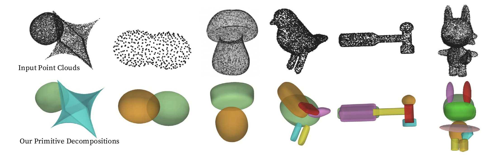
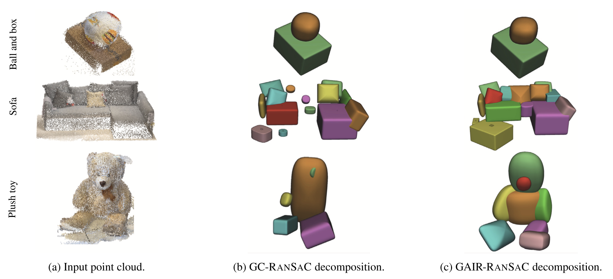

<div align="center">

# Superquadric Decomposition

### From 3D point clouds to geometric primitives

[](https://doi.org/10.1016/j.gmod.2026.101343)

**Superquadric primitive decomposition of 3D point clouds via geometric-aware inlier refinement**

Alessandro Rinaldi · Edoardo Tedesco · Andrea Ferraris · Filippo Leveni<br>
Daniele Baieri · Filippo Maggioli · Simone Melzi · Luca Magri

*Graphical Models*, Volume 148, Article 101343, 2026

[Read the paper](https://doi.org/10.1016/j.gmod.2026.101343) · [Run the notebook](explore_pointcloud.ipynb) · [Citation](#citation)

</div>

<p align="center">
  
  <br>
  <em>Complex shapes represented by collections of superquadric primitives.</em>
</p>

## Overview

This repository accompanies the paper linked above. It decomposes 3D point clouds into
superquadric primitives using **GAIR-RANSAC**, which refines inlier assignments through
graph cuts informed by geometric residuals and surface normals. A **RansaCov** model
selection step then chooses a subset of candidate primitives to maximize point coverage
under a user-defined limit on the number of models.

The exploratory notebook brings together fitting, baseline comparisons, quantitative
evaluation, and 3D visualization.

**Point cloud + normals → candidate fitting → geometric-aware refinement → model selection → decomposition**

## Qualitative comparison

<p align="center">
  
  <br>
  <em>Input point clouds (left), GC-RANSAC (center), and GAIR-RANSAC (right).</em>
</p>

## Quick start

### 1. Set up the environment

Requires **Python 3.11+**. Dependencies are listed in [pyproject.toml](pyproject.toml);
the commands below use [uv](https://docs.astral.sh/uv/).

```bash
git clone https://github.com/Tededo02/3D_superquadric_decomposition.git
cd 3D_superquadric_decomposition
uv sync
```

### 2. Choose a point cloud

Open [explore_pointcloud.ipynb](explore_pointcloud.ipynb) in VS Code or your Jupyter
environment and select the Python kernel from `.venv`. In **1. Configuration**, set:

```python
PC_PATH = ROOT / "data" / "point_clouds" / "bird.stl"
K = 5
```

`K` is the maximum number of superquadrics selected in the final decomposition.
Three sample inputs are included in [data/point_clouds](data/point_clouds/):
`bird.stl`, `cat1_0_0.ply`, and `supersingle0_0_0.ply`.

### 3. Run and inspect

Run the cells from top to bottom to load the cloud, compare the fitting methods,
inspect their metrics and reconstructions, and perform set-cover selection.
Visualization uses PyVista, with an inline interactive backend when available
and a separate desktop window otherwise. Close desktop visualization windows to
continue notebook execution.

> **Project status:** this is research code with a notebook-based workflow. The setup
> and API may evolve as the repository is cleaned up and extended.

## Methods and evaluation

The notebook compares four fitting strategies:

| Method | Configuration value | Refinement |
| :--- | :--- | :--- |
| RANSAC | `vanilla` | Standard consensus fitting |
| LO-RANSAC | `lo-ransac` | Local optimization |
| GC-RANSAC | `gc-ransac` | Graph-cut refinement with spatial coherence |
| **GAIR-RANSAC** | `gair-ransac` | **Graph-cut refinement using geometric residuals and normals** |

Candidate models are pooled across trials **separately for each algorithm**.
RansaCov selects at most `K` primitives from each pool by solving a maximum-coverage
mixed-integer optimization problem.

Reported metrics include Chamfer distance, its coverage and accuracy components,
Hausdorff distance, inlier/outlier classification rate, runtime, model count, and
the number of local optimizations.

## Inputs and configuration

- **Formats:** inputs are loaded with trimesh, including `.ply`, `.stl`, and `.obj`.
- **Normals:** for a bare point cloud, a sibling `normals_<filename>` file is used
  when present; otherwise normals are estimated. Mesh inputs use vertex normals.
- **Normalization:** the loader translates and scales the cloud so its longest
  bounding-box side has length 1.
- **Per-cloud settings:** [data/pc_configs.json](data/pc_configs.json) combines a
  `default` configuration with overrides keyed by the input filename stem.

| Setting | Where to change it | Purpose |
| :--- | :--- | :--- |
| `PC_PATH` | Notebook configuration | Input cloud or mesh |
| `K` | Notebook configuration | Maximum number of selected primitives |
| `ALGORITHMS` | Notebook configuration | Fitting methods to compare |
| `N_TRIALS`, `SEED` | Notebook configuration | Trial count and random seed |
| `OUTLIER_FRAC` | Notebook configuration | Fraction of synthetic uniform outliers to inject |
| `pipeline.MAX_LOAD_PTS` | Notebook configuration | Maximum number of input points after subsampling |
| `threshold` | `data/pc_configs.json` | Inlier residual threshold in normalized coordinates |

## Repository guide

| Path | Contents |
| :--- | :--- |
| [explore_pointcloud.ipynb](explore_pointcloud.ipynb) | Main entry point for experiments and visualization |
| [src/pipeline.py](src/pipeline.py) | Loading, configuration, fitting, and evaluation |
| [src/gair_ransac/](src/gair_ransac/) | RANSAC variants, graph-cut energies, and RansaCov selection |
| [src/superquadrics/](src/superquadrics/) | Superquadric parameters, residuals, meshing, and sampling |
| [src/visualizations/](src/visualizations/) | Visualization helpers |
| [data/](data/) | Sample point clouds and per-cloud configuration |
| [readme_img/](readme_img/) | Decomposition examples and qualitative comparison figures |

## Citation

If you use this work in your research, please cite the paper:

```bibtex
@article{rinaldi2026superquadric,
  title   = {Superquadric primitive decomposition of 3D point clouds via geometric-aware inlier refinement},
  author  = {Rinaldi, Alessandro and Tedesco, Edoardo and Ferraris, Andrea and
             Leveni, Filippo and Baieri, Daniele and Maggioli, Filippo and
             Melzi, Simone and Magri, Luca},
  journal = {Graphical Models},
  volume  = {148},
  pages   = {101343},
  year    = {2026},
  doi     = {10.1016/j.gmod.2026.101343},
  url     = {https://doi.org/10.1016/j.gmod.2026.101343}
}
```
